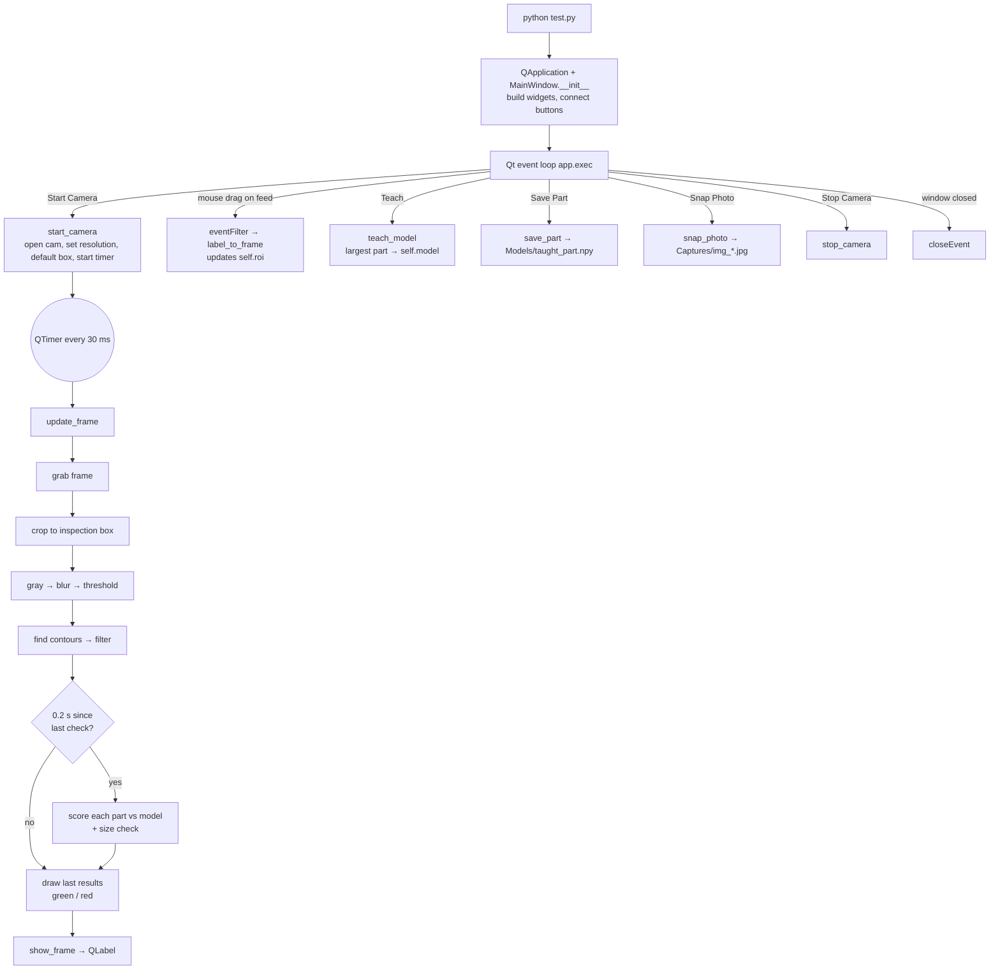

# Final Year Project: Code Explained

A detailed walkthrough of the vision inspection software for the conveyor reject system. This is a living document: update it every time a feature branch is merged (see [Keeping this document up to date](#13-keeping-this-document-up-to-date)).

| | |
|---|---|
| **Last updated** | 17 Nov 2026 |
| **Describes commit** | `71a9d4c` (branch `Save_Model`) |
| **Main source file** | `Code/test.py` (287 lines) |
| **Repo** | https://github.com/CathalBurke/Final_Year_Project |

> Line numbers in this document refer to `test.py` at the commit above. They will drift as the code changes, so update them when you update this doc.

---

## Contents

1. [What the program does right now](#1-what-the-program-does-right-now)
2. [How to run it](#2-how-to-run-it)
3. [Folder layout](#3-folder-layout)
4. [Big picture: how the program flows](#4-big-picture-how-the-program-flows)
5. [The window and its controls](#5-the-window-and-its-controls)
6. [State variables](#6-state-variables)
7. [Method by method walkthrough](#7-method-by-method-walkthrough)
8. [The vision pipeline explained](#8-the-vision-pipeline-explained)
9. [The three coordinate systems](#9-the-three-coordinate-systems)
10. [Tuning numbers in one place](#10-tuning-numbers-in-one-place)
11. [Known limitations and things to fix](#11-known-limitations-and-things-to-fix)
12. [Development history](#12-development-history)
13. [Keeping this document up to date](#13-keeping-this-document-up-to-date)
14. [References](#14-references)

---

## 1. What the program does right now

The program is a PySide6 desktop app that shows a live feed from a USB webcam (UGREEN 2K) and inspects parts (currently nuts) inside a user drawn inspection box.

Current capabilities:

- Start and stop the camera, open the camera driver settings, and snap timestamped photos.
- Drag a green **inspection box** (region of interest, ROI) on the live feed with the mouse.
- Convert the box contents to black and white with an adjustable **threshold**, and optionally show that black and white view.
- Find every **part outline (contour)** in the box, ignoring dust/noise and anything touching the box edge (fingers, cables).
- **Teach** a reference part by pressing a button: the biggest shape in the box becomes the model.
- Compare every detected part to the model **5 times a second**, giving a **shape score (0 to 100%)** that works in any orientation, plus a **size check** (within ±10% of the taught area).
- Draw each part **green (pass)** or **red (fail)** with a rotated bounding box and its score. Wrong sized parts show `SIZE DOESNT MATCH`.
- Adjustable **accept limit** slider (default 80%).
- **Save** the taught part outline to `Models/taught_part.npy`.

Not done yet: loading a saved model back in, conveyor motor control, servo reject output, running on the Raspberry Pi.

---

## 2. How to run it

**Requirements** (Python 3):

```bash
pip install opencv-python PySide6 numpy
```

**Run** from inside the `Code` folder (this matters, see [limitations](#11-known-limitations-and-things-to-fix), the `Captures` and `Models` folders are created relative to where you run it):

```bash
cd Code
python test.py
```

**Hardware assumptions in the code:**

- The webcam is camera **index 1** (index 0 is usually a laptop's built in camera).
- It is opened with **DirectShow** (`cv2.CAP_DSHOW`), which is **Windows only**.
- It asks for **2560×1440** using **MJPG** compression.

**Basic use:**

1. Press **Start Camera**. The status bar shows the real resolution the camera gave.
2. Drag a box around the area the part will sit in. Boxes smaller than 10 px are rejected.
3. Tick **Show threshold** and move the threshold slider until the part is solid white on black. Untick it again if you want the normal view.
4. Put one good part in the box and press **Teach**.
5. Set the **Accept** slider. Parts scoring at or above it (and the right size) go green, others go red.
6. Press **Save Part** to write the model to disk.

---

## 3. Folder layout

```
FInal Year Project/
├── Code/                      ← git repo
│   ├── test.py                ← the whole application (for now)
│   ├── .gitignore             ← ignores Captures/, __pycache__/, Models/
│   ├── Captures/              ← photos from "Snap Photo" (not in git)
│   └── Models/
│       └── taught_part.npy    ← saved taught contour (not in git)
└── Solidworks/                ← conveyor CAD (CB_01, CB_02, Vention STEP)
```

`Captures/` and `Models/` are deliberately ignored by git so test photos and taught parts don't clutter the repo.

---

## 4. Big picture: how the program flows

The whole program is one class, `MainWindow`. Nothing runs in a loop you wrote yourself. Instead, Qt's event loop calls your methods when something happens:

- **Button clicks** call the method connected to that button.
- **A `QTimer`** fires every 30 ms while the camera is running and calls `update_frame()`. This is what makes it "live".
- **Mouse events** on the video label are caught by `eventFilter()` and used to draw the inspection box.



---

## 5. The window and its controls

Built in `__init__` (lines 37 to 104). The window is 800×600, titled "Camera Viewer".

**Layout:** a vertical layout (`QVBoxLayout`) holds the video label on top and a horizontal row of controls (`QHBoxLayout`) underneath. The layout sits in a plain `QWidget` that is set as the window's central widget, because a `QMainWindow` needs a central widget rather than a layout directly.

| Control | Type | What it does | Connected to |
|---|---|---|---|
| `label` | `QLabel` | Displays the video. Dark `#111` background, says "Camera Stopped" when idle | `eventFilter` (mouse) |
| `btn_start` | `QPushButton` | Opens the camera | `start_camera` |
| `btn_stop` | `QPushButton` | Stops the camera. Disabled until the camera starts | `stop_camera` |
| `btn_snap` | `QPushButton` | Saves the current raw frame as a JPG | `snap_photo` |
| `btn_save` | `QPushButton` | Saves the taught model to disk | `save_part` |
| `btn_settings` | `QPushButton` | Opens the webcam driver settings dialog | `open_settings` |
| `chk_thresh` | `QCheckBox` | Show the black and white threshold view inside the box | read in `update_frame` |
| `slider` | `QSlider` 0 to 255 | Threshold level, default 127 | read in `update_frame` |
| `btn_teach` | `QPushButton` | Teaches the biggest part in the box | `teach_model` |
| `lbl_accept` | `QLabel` | Shows "Accept: NN%" | updated by lambda |
| `accept_slider` | `QSlider` 0 to 100 | Minimum score to pass, default 80 | read in `update_frame` |
| status bar | `QStatusBar` | Temporary messages (3 to 5 s) | many methods |

The accept label is kept in sync with a one line **lambda** (line 95): every time the slider value changes, `valueChanged` passes the new value `v` and the label text is set to `f"Accept: {v}%"`.

---

## 6. State variables

All declared at the top of `__init__` (lines 26 to 35). Declaring them up front avoids `AttributeError`s when a method runs before another has set them (this was the bug noted in commit `54a2863`).

| Variable | Holds | Set by | Used by |
|---|---|---|---|
| `self.cap` | The `cv2.VideoCapture` camera object | `start_camera` | `update_frame`, `stop_camera`, `open_settings`, `closeEvent` |
| `self.frame` | Latest raw camera frame (no drawings) | `update_frame` | `snap_photo`, `label_to_frame`, `eventFilter` |
| `self.roi` | Inspection box as `(x1, y1, x2, y2)` in **frame pixels** | `start_camera`, `eventFilter` | `update_frame` |
| `self.prev_roi` | Box before the current drag, to restore if the new one is too small | `eventFilter` | `eventFilter` |
| `self.drag_start` | Frame coordinate where the mouse was pressed, or `None` when not dragging | `eventFilter` | `eventFilter` |
| `self.parts` | List of contours that passed the filters on the latest frame | `update_frame` | `teach_model` |
| `self.results` | List of inspection results, refreshed 5× a second | `update_frame` | `update_frame` (drawing) |
| `self.last_check` | Time (seconds) of the last inspection | `update_frame` | `update_frame` |
| `self.model` | The taught contour (NumPy array of points) or `None` | `teach_model` | `update_frame`, `save_part` |
| `self.model_area` | Area of the taught contour in pixels² | `teach_model` | `update_frame` (size check) |
| `self.timer` | `QTimer` driving the live loop | `__init__` | `start_camera`, `stop_camera`, `closeEvent` |

---

## 7. Method by method walkthrough

### 7.1 The old test block (lines 1 to 12)

The first 12 lines are the original OpenCV camera test from commit `d17eb37`, wrapped in a triple quoted string so Python ignores it. It is a plain `while True` loop using `cv2.imshow`. It is kept for reference only and does nothing.

### 7.2 `__init__` (lines 23 to 104)

Builds the window: declares state, creates widgets, arranges layouts, connects signals to slots, creates the timer (not started yet), shows "Ready" in the status bar, and installs the event filter on the video label so mouse events on it are passed to `eventFilter`.

**Signals and slots** is Qt's way of wiring events to code: `self.btn_start.clicked.connect(self.start_camera)` means "when this button emits its `clicked` signal, call `start_camera`".

### 7.3 `open_settings` (lines 106 to 108)

```python
self.cap.set(cv2.CAP_PROP_SETTINGS, 1)
```

Asks the DirectShow driver to open the camera's own settings dialog (exposure, focus, white balance, etc.). Only works on Windows with DirectShow, and only while the camera is open.

### 7.4 `start_camera` (lines 111 to 131)

1. Opens camera index **1** with the **DirectShow** backend.
2. If it fails to open, shows "Failed to open camera" and returns (added in `8ec2eb1`).
3. Requests **2560×1440** and **MJPG**. MJPG matters: uncompressed video at 2K is too much data for USB, so without MJPG the camera falls back to a much lower resolution or frame rate.
4. Reads back the width and height the camera **actually** gave, because a camera can ignore the request.
5. Sets a default inspection box in the centre, half the width and half the height of the frame: `(w/4, h/4, 3w/4, 3h/4)`. `//` is integer division so the coordinates are whole pixels.
6. Starts the timer at 30 ms (about 33 updates per second, a bit faster than the camera's 30 fps so no frames are missed).
7. Disables Start, enables Stop, shows the resolution in the status bar.

### 7.5 `stop_camera` (lines 133 to 140)

Stops the timer first (so `update_frame` doesn't try to read a released camera), releases the camera, clears the label back to "Camera Stopped", and swaps which buttons are enabled.

### 7.6 `update_frame` (lines 142 to 206), the core of the program

Called by the timer every 30 ms. The vision theory behind each step is explained in [section 8](#8-the-vision-pipeline-explained); this is what the code does in order.

**Step 1: grab the frame (lines 143 to 147)**
```python
ok, frame = self.cap.read()
```
If the read fails, nothing happens this tick. `self.frame` keeps the clean frame (used by Snap Photo and the mouse mapping), and `display` is a **copy** that gets drawn on. Drawing on a copy means saved photos never contain the green boxes.

**Step 2: crop to the inspection box (lines 147 to 150)**
```python
roi = frame[y1:y2, x1:x2]
```
NumPy slicing, rows (y) first then columns (x). The `roi.size > 0` check skips processing if the box has no area, which happens for a moment while dragging a new box (fix from `bf447bd`).

**Step 3: grayscale, blur, threshold (lines 151 to 153)**
```python
gray = cv2.cvtColor(roi, cv2.COLOR_BGR2GRAY)
gray = cv2.GaussianBlur(gray, (5, 5), 0)
_, mask = cv2.threshold(gray, self.slider.value(), 255, cv2.THRESH_BINARY)
```
Result: `mask` is a black and white image where pixels brighter than the slider value are white (255) and everything else is black (0).

**Step 4: optional threshold view (lines 155 to 156)**
If the checkbox is ticked, the box area of `display` is replaced with the mask (converted back to 3 channels so it fits in the colour image). This only changes what you see; detection always runs on the mask (change from `0bc9148`).

**Step 5: find and filter contours (lines 158 to 170)**
```python
contours, _ = cv2.findContours(mask, cv2.RETR_EXTERNAL, cv2.CHAIN_APPROX_SIMPLE)
```
Each contour is checked:
- Area under **500 px²**: skipped as dust or noise.
- Bounding rectangle within **1 px of any edge of the box**: skipped, because a real part sits fully inside the box, while a finger, cable or part half in view touches the edge.

Survivors go into `self.parts`, which `teach_model` uses.

**Step 6: inspect, 5 times a second (lines 174 to 188)**

Only runs if at least 0.2 s have passed since the last inspection (`time.time()` is seconds as a decimal). Running every frame made the score flicker; a fixed rate keeps it readable (`9a018af`). For each part it calculates:

| Value | How | Why |
|---|---|---|
| `x, y, w, h` | `cv2.boundingRect(c)` | Upright box, used to place the text |
| `rect` | `cv2.minAreaRect(c)` | Smallest rotated box, follows the part's angle |
| `score` | `100 * (1 - matchShapes(...))`, min 0 | Shape similarity to the model |
| `size_ok` | area within ±10% of model area | Catches right shape, wrong size (e.g. M6 vs M8 nut) |

If no model is taught, `score` stays `None` and `size_ok` stays `True`.

Each result is stored as a tuple `(c, x, y, w, h, rect, score, size_ok)` in `self.results`.

**Step 7: draw the results, every frame (lines 190 to 205)**

Results are drawn every frame even though they are only recalculated every 0.2 s, so the drawings don't blink.

Line and text size scale with resolution so they look the same at any camera size:
```python
fs = frame.shape[1] / 800     # 2560 wide → 3.2
th = max(2, int(fs * 2))      # 2560 wide → 6 px lines
```

Pass/fail colour logic (line 194):
```python
if score is not None and score < self.accept_slider.value() or not size_ok:
    colour = red
```
Python evaluates `and` before `or`, so this reads as **(model taught AND score below limit) OR wrong size**.

| Model taught? | Score vs limit | Size OK? | Colour | Label |
|---|---|---|---|---|
| No | n/a | (always True) | Green | none, outline only |
| Yes | ≥ limit | Yes | Green | `87%` |
| Yes | < limit | Yes | Red | `62%` |
| Yes | any | No | Red | `87% SIZE DOESNT MATCH` |

Then it draws:
- the part outline,
- the rotated box (only when a model is taught), using `cv2.boxPoints` to turn the rotated rect into 4 corner points,
- the score text just above the part.

All of these are offset by `[x1, y1]` because contours are in **box coordinates** and need to be moved into **frame coordinates** (see [section 9](#9-the-three-coordinate-systems)).

Finally the green inspection box is drawn (2 px) and the frame is sent to `show_frame`.

### 7.7 `teach_model` (lines 210 to 217)

```python
self.model = max(self.parts, key=cv2.contourArea)
```
Picks the **largest** part currently in the box as the reference. `key=cv2.contourArea` tells `max` to compare contours by their area. The area is stored in `self.model_area` for the size check and shown in the status bar. If nothing is detected, it says so and does nothing.

### 7.8 `save_part` (lines 219 to 225)

Refuses if nothing is taught. Otherwise creates `Models/` if needed (`exist_ok=True` stops an error if it already exists) and saves the contour with `np.save`. The file is a NumPy array of shape `(N, 1, 2)`: N outline points, each an (x, y) pair. It can be loaded back with `np.load("Models/taught_part.npy")`, which is not wired up yet.

### 7.9 `show_frame` (lines 228 to 233)

Converts an OpenCV image into something a `QLabel` can show:

1. OpenCV stores colour as **BGR**, Qt expects **RGB**, so the channels are swapped.
2. A `QImage` is built on the same memory. `ch * w` is the **bytes per line** (3 bytes per pixel × width), which Qt needs to step through rows correctly.
3. It is turned into a `QPixmap` and scaled to the label size, keeping the aspect ratio. `SmoothTransformation` is used because the default fast scaling dropped thin lines when shrinking 2560 px down to around 800 px (fix from `4e0c3e9`).

### 7.10 `label_to_frame` (lines 235 to 245)

Converts a mouse position on the label into a pixel position in the camera frame. Needed because the frame is shown shrunk and centred with black bars. Full explanation with a worked example in [section 9](#9-the-three-coordinate-systems).

### 7.11 `eventFilter` (lines 247 to 264)

Installed on the video label, so Qt passes every event for the label through here first. It only acts when a frame exists.

| Event | Action |
|---|---|
| `MouseButtonPress` | Remember the current box in `prev_roi`, store the start point (in frame coords) |
| `MouseMove` while dragging | Update `self.roi` live. `min`/`max` make it work whichever direction you drag |
| `MouseButtonRelease` | End the drag. If the box is under 10 px wide or tall, restore `prev_roi` (so a stray click doesn't wipe the box) |

It always ends with `return super().eventFilter(obj, event)` so Qt still handles the event normally.

### 7.12 `snap_photo` (lines 267 to 275)

Saves the clean `self.frame` (no overlays) to `Captures/img_DDMMYYYY_HHMMSS.jpg` using `time.strftime`, creating the folder if needed, and shows the filename in the status bar.

### 7.13 `closeEvent` (lines 277 to 281)

Qt calls this automatically when the window is closed. It stops the timer and releases the camera so the webcam isn't left locked by a dead process.

### 7.14 Main block (lines 283 to 287)

`if __name__ == "__main__":` means this only runs when the file is run directly, not imported. It creates the `QApplication` (one per program), shows the window, and starts the event loop with `app.exec()`. `sys.exit` passes the app's exit code back to the operating system.

---

## 8. The vision pipeline explained

### 8.1 Grayscale
Colour isn't needed to find an outline, and one channel is three times less data than BGR. Every later step works on single channel images.

### 8.2 Gaussian blur (5×5)
Smooths out sensor noise and tiny surface texture so the threshold gives clean edges instead of speckle. The kernel is 5×5 pixels; the `0` tells OpenCV to work out the blur strength (sigma) from the kernel size.

### 8.3 Binary threshold
Every pixel is compared to one fixed value **T** (the slider):

```
pixel > T  →  255 (white)
pixel ≤ T  →  0   (black)
```

This separates part from background, **assuming the part is brighter than the background**. If the background ends up brighter than the part (e.g. a light belt), `THRESH_BINARY_INV` would be needed.

### 8.4 Contours
`cv2.findContours` traces the boundaries of white areas in the mask.
- `RETR_EXTERNAL` returns **outer outlines only**. For a nut this means the hex outline is found but the hole in the middle is ignored.
- `CHAIN_APPROX_SIMPLE` stores only the corner points of straight runs, which saves memory (a straight edge becomes 2 points instead of hundreds).

### 8.5 Filtering
- **Minimum area 500 px²** removes dust and noise.
- **Edge rejection** removes anything touching the box border, which is how fingers, cables and half visible parts are excluded.

### 8.6 Shape matching with Hu moments
`cv2.matchShapes(model, c, cv2.CONTOURS_MATCH_I1, 0.0)` compares two outlines using **Hu moments**: 7 numbers calculated from a shape that stay the same when the shape is **moved, rotated or scaled**. That's why a part is recognised in any orientation without searching every angle.

`matchShapes` returns a distance **d**: 0 means identical shapes, bigger means more different. The code turns it into a percentage:

```
score = max(0, 100 × (1 − d))
```

| d | score |
|---|---|
| 0.00 | 100% |
| 0.05 | 95% |
| 0.20 | 80% |
| ≥ 1.00 | 0% (clamped) |

This is a confidence style rating, not a true probability.

### 8.7 Size check
Because Hu moments ignore scale, a big nut and a small nut of the same hex shape score almost the same. The size check fixes this:

```
|area − model_area| / model_area < 0.10
```

The part must be within ±10% of the taught area. Area is in pixels², so it only works if the camera height and resolution stay the same between teaching and running.

### 8.8 Rotated bounding box
`cv2.minAreaRect` finds the smallest rectangle around the part at any angle, returning centre, size and angle. `cv2.boxPoints` converts that into 4 corners for drawing. This shows the part's orientation and will be useful later if position or angle needs to be reported.

---

## 9. The three coordinate systems

The code juggles three different sets of coordinates. Most bugs in this kind of program come from mixing them up.

| System | Origin (0,0) | Size | Used for |
|---|---|---|---|
| **Label** | Top left of the `QLabel` widget | Label size, e.g. ~780×520 | Mouse positions from Qt |
| **Frame** | Top left of the camera image | 2560×1440 | `self.roi`, drawing, saving photos |
| **Box (ROI)** | Top left of the inspection box | Box size | Contours, bounding rects |

### Label → frame (`label_to_frame`)

`show_frame` shrinks the frame to fit the label while keeping its shape, so there are empty bars on two sides. To reverse it:

```python
scale = min(lw / fw, lh / fh)       # same shrink factor show_frame used
off_x = (lw - fw * scale) / 2       # width of empty bar on the left
off_y = (lh - fh * scale) / 2       # height of empty bar on top
x = (mouse_x - off_x) / scale
y = (mouse_y - off_y) / scale
```

Then it clamps the result so it can never land outside the frame.

**Worked example** (label 780×520, frame 2560×1440):

- `scale = min(780/2560, 520/1440) = min(0.305, 0.361) = 0.305`
- Shown image is 780 × 439, so `off_x = 0`, `off_y = (520 − 439)/2 ≈ 40.6`
- Click the middle of the label (390, 260):
  `x = 390 / 0.305 ≈ 1280`, `y = (260 − 40.6) / 0.305 ≈ 720`
- That's the centre of the 2560×1440 frame, as expected.

### Box → frame

Contours are found on the cropped box image, so their points start from the box's corner. To draw them on the full frame, the box's top left corner `(x1, y1)` is added:

```python
c + [x1, y1]                                         # NumPy adds to every point
cv2.boxPoints(rect).astype("int32") + [x1, y1]
(x1 + x, y1 + y - ...)                               # text position
```

---

## 10. Tuning numbers in one place

| Value | Where | Meaning | Notes |
|---|---|---|---|
| `1` | `start_camera` | Camera index | Will change on the Pi |
| `2560 × 1440`, MJPG | `start_camera` | Requested resolution | Actual size read back |
| `30` ms | `start_camera` | Timer interval | ~33 Hz |
| `127` | slider default | Threshold level | Depends on lighting |
| `(5, 5)` | `update_frame` | Blur kernel | Bigger = smoother, less detail |
| `500` px² | `update_frame` | Minimum part area | Scales with resolution |
| `1` px | `update_frame` | Edge rejection margin | |
| `0.2` s | `update_frame` | Inspection period (5 Hz) | |
| `0.1` | `update_frame` | Size tolerance (±10%) | |
| `80` % | accept slider default | Pass limit | |
| `800` | `update_frame` | Reference width for text/line scaling | |
| `10` px | `eventFilter` | Minimum box size | |

---

## 11. Known limitations and things to fix

Honest notes on where the current code would trip up. Tick these off (or move them to the history) as they get fixed.

**Features not finished**
- [ ] **No Load Model.** `save_part` writes `taught_part.npy` but nothing reads it back, so the part must be re-taught every launch.
- [ ] The saved file only holds the outline. The threshold, model area, resolution and box position used when teaching aren't saved, so a reloaded model could behave differently.
- [ ] No output yet to the conveyor motor or reject servo.

**Portability (matters for the Raspberry Pi)**
- [ ] `cv2.CAP_DSHOW` and `CAP_PROP_SETTINGS` are **Windows only**. On the Pi the backend will be V4L2 (`cv2.CAP_V4L2`) and the camera index will probably be 0.
- [ ] All image processing runs on the GUI thread at 2560×1440. That's fine on a laptop but could make the GUI laggy on a Pi. Options: a lower resolution, processing only the box (already done), or a worker thread.
- [ ] `Captures/` and `Models/` are relative paths, so they're created wherever the program is launched from, not always next to `test.py`. Building paths from `os.path.dirname(__file__)` would fix that.

**Vision behaviour**
- [ ] A fixed threshold is sensitive to lighting changes. Consistent lighting (or automatic Otsu thresholding) would help.
- [ ] `THRESH_BINARY` assumes the part is brighter than the background.
- [ ] `RETR_EXTERNAL` ignores holes, so a nut with **no hole or a blocked hole** would still pass the shape check if the outer hex is right.
- [ ] The size check is in pixels, so moving the camera or changing resolution after teaching breaks it.
- [ ] Results update every 0.2 s, so outlines on a **moving conveyor** will trail the part slightly. That's fine on a still bench but worth revisiting once the belt runs.
- [ ] Teach takes the **largest** shape, so only one part should be in the box while teaching.
- [ ] With no model taught, every detected shape shows green.

**Small tidy ups**
- [ ] If `cap.read()` fails mid run (e.g. camera unplugged) the timer keeps going silently with no message.
- [ ] Line 194 works correctly but brackets would make the intent obvious: `if (score is not None and score < limit) or not size_ok:`
- [ ] `teach_model` calculates the contour area twice (lines 215 and 216).
- [ ] The old test block at the top of the file and the commented out `drawContours` on line 171 could be removed.
- [ ] `test.py` could be renamed (e.g. `main.py`) now that it's the real app.
- [ ] Comment typo line 31: "tought" → "taught".

---

## 12. Development history

Workflow: each feature is built on its own branch, merged into `Test` with a pull request, then `Test` is merged into `main`.

```
Frame_1 ─┐
Frame_2 ─┼─► Test ─► main
Contours ┘
Save_Model ─► (not merged yet)
```

### Initial GUI (on `Test`), 23 Sep 2026
| Commit | Change |
|---|---|
| `38c7ed3` | Set up repo and created a test file |
| `d17eb37` | Tested basic OpenCV camera use (the block now at the top of `test.py`) |
| `6d7bb37` | Basic PySide6 main window |
| `44f2b26` | Layout with feed label and Start/Stop buttons |
| `825a78a` | Centred dark feed label, Snap Photo button |
| `e2910a1` | Connected buttons to methods, enable/disable logic |
| `feb3848` | Live camera feed using a `QTimer` |
| `d2f7e14` | `closeEvent` releases the camera when the window closes |
| `53c5864` | Snap Photo saves timestamped images |
| `d049c07` | Filename shown in status bar, date format fixed to DDMMYYYY, folder renamed to `Captures` |
| `973cada` | Status bar messages for start, stop and ready |

### `Frame_1`, 24 Sep 2026
| Commit | Change |
|---|---|
| `c1ae235` | Green inspection box drawn in the centre, sized from the resolution |
| `2cff780`, `470c55d` | Comments and sectioning tidied (on `Test`) |

### `Frame_2`, 24 to 30 Sep 2026
| Commit | Change |
|---|---|
| `bc7e4cf` | Mouse press, drag and release captured on the feed |
| `54a2863` | Inspection box drawn by dragging, with label → frame coordinate conversion. Variables moved to top of `__init__` |
| `81b7e61` | Correct camera opened at full resolution with MJPG, actual resolution shown |
| `9d3edac` | Boxes under 10 px rejected, previous box kept |
| `5e198dc` | Show threshold checkbox and slider |
| `d6d7d20` | Comments modified (on `main`) |

### `Contours`, 12 Oct to 2 Nov 2026
| Commit | Change |
|---|---|
| `8ec2eb1` | Camera open check, `snap_photo` indentation fix, `.gitignore` added |
| `0bc9148` | Threshold runs every frame; checkbox only controls the display |
| `7fcf2ca` | Contour detection inside the box |
| `98eb1f0` | Minimum area filter (500 px²) |
| `57a0475` | Teach button: largest shape becomes the model |
| `bf447bd` | Fixed crash when the box has no area during a drag |
| `0792ad3` | Shape matching with confidence % and resolution scaled drawing |
| `9a018af` | Inspection fixed at 5× a second, score rounded |
| `1cf1448` | Shapes touching the box edge ignored |
| `0dc33b8` | Accept limit slider, green/red pass/fail |
| `4e0c3e9` | Smooth scaling fixes disappearing lines |
| `0cc7029` | Rotated bounding box with `minAreaRect` |
| `f9fa575` | Size check against taught area, `SIZE DOESNT MATCH` label |

Merged to `Test` (PR #4) and `main` (PR #5).

### `Save_Model`, 13 Nov 2026
| Commit | Change |
|---|---|
| `71a9d4c` | Save Part button writes `Models/taught_part.npy`; `Models/` added to `.gitignore` |

At the time of writing this branch is local only and not yet pushed or merged.

---

## 13. Keeping this document up to date

Do this each time a feature branch is merged into `Test`:

1. Update **Last updated** and **Describes commit** at the top.
2. Add the new commits to [Development history](#12-development-history) under a new branch heading.
3. Update [What the program does right now](#1-what-the-program-does-right-now).
4. Add or edit the walkthrough for any new or changed methods in [section 7](#7-method-by-method-walkthrough), and fix line numbers that moved.
5. Add any new state variables (section 6), controls (section 5) or tuning numbers (section 10).
6. Tick off fixed items in [Known limitations](#11-known-limitations-and-things-to-fix) and add any new ones.
7. Add an entry to the change log below.
8. Commit the doc along with the code, e.g. `Updated CODE_EXPLAINED.md for the Load_Model branch`.

Handy command to list commits since the last update:

```bash
git log --oneline --no-merges 71a9d4c..HEAD
```

### Document change log
| Date | Commit described | Changes to this doc |
|---|---|---|
| 17 Nov 2026 | `71a9d4c` | First version, covering everything up to Save Part |

---

## 14. References

**OpenCV**
- Getting started with video: https://docs.opencv.org/4.x/dd/d43/tutorial_py_video_display.html
- Smoothing images (Gaussian blur): https://docs.opencv.org/4.x/d4/d13/tutorial_py_filtering.html
- Image thresholding: https://docs.opencv.org/4.x/d7/d4d/tutorial_py_thresholding.html
- Contours, getting started: https://docs.opencv.org/4.x/d4/d73/tutorial_py_contours_begin.html
- Contour features (area, boundingRect, minAreaRect): https://docs.opencv.org/4.x/dd/d49/tutorial_py_contour_features.html
- Contours, more functions (matchShapes): https://docs.opencv.org/4.x/d5/d45/tutorial_py_contours_more_functions.html
- Shape matching using Hu moments (LearnOpenCV): https://learnopencv.com/shape-matching-using-hu-moments-c-python/

**Qt / PySide6**
- PySide6 documentation: https://doc.qt.io/qtforpython-6/
- QTimer: https://doc.qt.io/qtforpython-6/PySide6/QtCore/QTimer.html
- Signals and slots: https://doc.qt.io/qtforpython-6/tutorials/basictutorial/signals_and_slots.html
- Event filters (QObject.eventFilter): https://doc.qt.io/qtforpython-6/PySide6/QtCore/QObject.html

**NumPy**
- numpy.save: https://numpy.org/doc/stable/reference/generated/numpy.save.html
